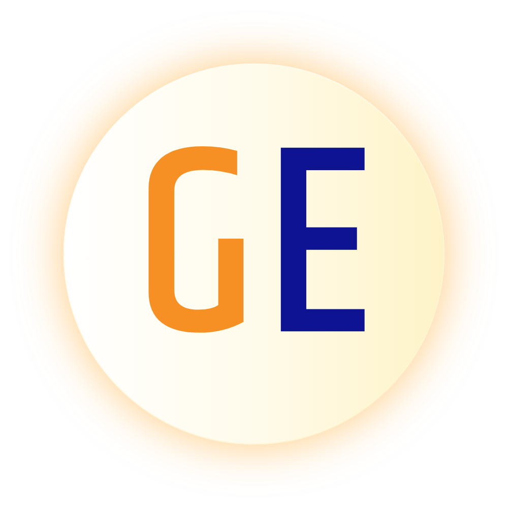
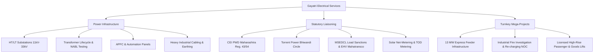

<p align="center">
  <a href="https://gayatrielectrical.in">
    
  </a>
</p>

<h1 align="center">Gayatri Electrical Services (GES)</h1>

<p align="center">
  <strong>Govt. Authorized Electrical Contractor (Est. 2003) & Licensed Lift Contractor</strong><br>
  <em>Turnkey High-Tension (HT up to 33kV/100kV) & Low-Tension (LT) Power Infrastructure • 13 MW Turnkey Express Feeders • Industrial Substations • Statutory Regulatory Liaisoning</em>
</p>

<p align="center">
  <a href="https://gayatrielectrical.in"></a>
  <a href="#agentic-ai-seo"></a>
  <a href="#pwa-web-standards"></a>
  <a href="#typography"></a>
  <a href="#multilingual"></a>
  <a href="LICENSE"></a>
  <a href="https://github.com/aadeshdubey/ges"></a>
</p>

<p align="center">
  <a href="#executive-summary">Executive Summary</a> •
  <a href="#key-metrics">Key Metrics</a> •
  <a href="#services">Services</a> •
  <a href="#industrial-sectors">Industries</a> •
  <a href="#statutory-liaisoning">Statutory Liaisoning</a> •
  <a href="#agentic-ai-seo">Agentic AI & SEO</a> •
  <a href="#pwa-web-standards">PWA & Standards</a> •
  <a href="#typography">Typography</a> •
  <a href="#multilingual">Multilingual</a> •
  <a href="#repository-structure">Architecture</a> •
  <a href="#version-management">Sync & CI/CD</a>
</p>

---

<a id="executive-summary"></a>
## Executive Summary

**Gayatri Electrical Services (GES)** is an engineering contracting firm established in 2003 in Bhiwandi (Thane District, Maharashtra). Operating under official Government Electrical Contractor Licenses issued by the Energy Department, Government of Maharashtra, GES engineers turnkey **High-Tension (HT up to 33kV/100kV)**, **Low-Tension (LT)**, and **Ultra-Heavy Express Feeder** power infrastructure for manufacturing facilities, logistics mega-parks, and industrial plants.

All contracting projects, transformer installations, and liaisoning services are billed through official GST invoices and settled via institutional electronic banking (RTGS, NEFT, IMPS, Account Payee Cheques, and Corporate UPI).

---

<a id="key-metrics"></a>
## Key Metrics

| Metric | Benchmark | Engineering Details |
| :--- | :---: | :--- |
| **Operational Track Record** | `20+ Years` | Continuous contracting excellence since 2003 across Western Maharashtra |
| **Transformer Lifecycle Assets** | `500+ Units` | Erection, repair, NABL testing, BDV vacuum dehydration (100 kVA to 5,000 kVA) |
| **Substations Commissioned** | `100+ Turnkey` | 11kV, 22kV, 33kV & 100kV indoor/outdoor AIS & GIS industrial switchyards |
| **Flagship Mega-Feeder** | `13 MW Load` | Dual 6.5 MW dedicated turnkey express feeders executed for **APCO Infratech** |
| **Statutory Liaisoning Bodies** | `Key Authorities` | CEI PWD (Govt. of Maharashtra), MSEDCL (Mahavitaran), MSETCL (Mahatransco), Torrent Power, Lift Inspectorate (Govt. of Maharashtra) |
| **Regulatory Safety Record** | `100% Zero-Defect` | Flawless compliance under Regulation 43 of CEA Safety Regulations |

---

<a id="services"></a>
## Turnkey Engineering Capabilities



<details>
<summary><strong>Click to view detailed service modules and engineering scope</strong></summary>

1. **Transformer Lifecycle Management**:
   - Turnkey supply, civil plinth erection, cable termination, and commissioning (100 kVA to 5,000 kVA).
   - On-site multi-stage High-Vacuum Oil Filtration & Dehydration (restoring BDV > 60 kV).
   - NABL-traceable electrical diagnostics: Insulation Resistance (Megger), Magnetic Balance, Vector Group, Winding Resistance, Dissolved Gas Analysis (DGA).
   - Emergency standby replacement transformer fleet (ready dispatch to minimize industrial downtime).

2. **High-Voltage (HV/HT) Substations (11kV / 22kV / 33kV)**:
   - Indoor/outdoor AIS (Air Insulated Switchgear) & GIS (Gas Insulated Switchgear) switchyards.
   - Vacuum Circuit Breaker (VCB) panels, SF6 ring main units (RMU), gang-operated (GO) air-break switches, and lightning arresters.
   - Comprehensive protective relay coordination (numerical overcurrent, earth fault, differential, master trip 86 relays).

3. **Custom Industrial Panel Systems (HT, LT & APFC)**:
   - Main LT Distribution Switchboards (up to 4000A with ACB/MCCB segregation, IP54/55 enclosures).
   - Automatic Power Factor Correction (APFC) panels maintaining unity power factor (>0.99) to eliminate utility penalty surcharges and unlock 7% load incentives.
   - Motor Control Centers (MCC), VFD drives, PLC automation panels, and Synchronizing Auto-Changeover AMF panels for multi-DG synchronization.

4. **Industrial Cabling & Deep Earth Pit Grids**:
   - HT XLPE (11kV/22kV/33kV) cable laying in trenches, ducts, racks, and underground micro-tunneling with Raychem heat-shrink terminations.
   - Complete chemical maintenance-free earthing grid installation using copper-bonded electrodes and low-resistivity carbonaceous backfill compound (< 1.0 Ohm earth pit resistance).

5. **Turnkey Solar Grid Liaisoning & Bi-Directional Net-Metering**:
   - Industrial rooftop and ground-mounted solar grid-tie electrical engineering.
   - Discom technical feasibility approvals (Torrent Power / MSEDCL), bi-directional Time-of-Day (TOD) net-metering synchronization, and CEI plant safety inspection certificates.

6. **Government Authorized Lift Erection & Safety Clearances**:
   - Turnkey erection, modernization, and annual maintenance for industrial goods elevators, passenger lifts, and automated warehouse dumbwaiters under the Maharashtra Lifts Act.

</details>

---

<a id="industrial-sectors"></a>
## Industrial Sectors Powered by GES

> [!NOTE]
> **Scope of Power Delivery**: Gayatri Electrical Services provides the **turnkey incoming electrical power infrastructure**—from utility tap-off points, overhead/underground lines, HT substations, transformers, and metering cubicles up to the **Main LT Distribution Panels and APFC Capacitor Banks**. GES supplies reliable electrical energy *to* these industrial facilities to power their operations.

| # | Industrial Client Sector | Turnkey Power Infrastructure Provided by GES |
| :-: | :--- | :--- |
| **01** | **Glass & Toughened Processing Plants** | Turnkey HT substations, dual VCB auto-changeover switchgear, harmonic suppression panels |
| **02** | **Ceramics & Refractory Kilns** | Dedicated transformer substations, high-current busducts to main LT distribution boards |
| **03** | **Printing & Flexible Packaging Units** | HT incoming connections, main LT distribution switchboards, APFC capacitor banks |
| **04** | **Paper Mills & Corrugated Packaging** | Heavy-duty transformer installations, motor control centers (MCC), sub-distribution panels |
| **05** | **Textile Mills & Automatic Loom Sheds** | 24/7 continuous HT power supply lines, main LT panels, busbar trunking systems |
| **06** | **Yarn Processing & Dyeing Facilities** | Substation erection, chemical-resistant feeder cabling, central power distribution switchboards |
| **07** | **Agricultural Pipes & Irrigation Extrusion** | High-capacity transformer yards, heavy main LT distribution boards, power factor correction |
| **08** | **Rubber & Polymer Moulding Plants** | HT transformer setup, main LT switchgear, high-inrush APFC banks |
| **09** | **Chemical & Pharmaceutical Plants** | Complete HT substation, flameproof (FLP / Ex-d) distribution panels, dedicated earth grids |
| **10** | **Paints, Resins & Solvents Formulations** | Zone-1 compliant power distribution panels, static grounding grids, transformer bays |
| **11** | **Cold Storage Multi-Chamber Logistics** | Dual-source HT incomers, transformer setups, automatic AMF changeover panels |
| **12** | **Multi-Tier Warehousing & Logistics Parks** | Large-scale HT power distribution, main LT switchgear, energy-efficient power busways |
| **13** | **Office Furniture & Precision Casting** | Incomer HT switchyard, busduct risers, factory floor main LT power panels |
| **14** | **Commercial Food Processing Mills** | Clean-room LT power switchboards, dedicated transformer substation, earthing networks |
| **15** | **Stone Quarries & Steel Induction Mills** | Heavy HT/EHV incomers, high-current transformer switchgear, vibration-resistant panels |
| **16** | **Commercial Towers & High-Rise Hubs** | Multi-tier electrical rising mains, busduct systems, dual-source emergency switchgear |
| **17** | **Automotive Ancillaries & Die Casting** | Dedicated HT express lines, heavy transformer bays, main LT motor control centers |
| **18** | **Data Centers & Enterprise IT Hubs** | Dual-redundant HT incomer substations, clean-power distribution switchboards, earthing |

---

<a id="statutory-liaisoning"></a>
## Statutory Liaisoning Matrix

GES coordinates official administrative clearances across government regulatory authorities with zero compliance delays:

```
┌────────────────────────────────────────────────────────────────────────┐
│               GOVERNMENT STATUTORY REGULATORY BODIES                   │
├──────────────────┬───────────────────┬─────────────────────────────────┤
│ Statutory Body   │ Jurisdiction      │ Handled Scope & Clearances      │
├──────────────────┼───────────────────┼─────────────────────────────────┤
│ Chief Electrical │ State of          │ • CEA Regulation 43/54 Approval │
│ Inspectorate     │ Maharashtra       │ • Form A & Form B Submissions   │
│ (CEI / PWD)      │ (PWD Energy Dept) │ • DG Set Charging Permission    │
│                  │                   │ • Post-Fire Investigation NOC   │
├──────────────────┼───────────────────┼─────────────────────────────────┤
│ Torrent Power    │ Bhiwandi Circle   │ • HT & LT New Service Direct    │
│ Limited          │ Franchise Area    │ • Load Sanctioning & CT/PT Unit │
│                  │                   │ • TOD Metering & Substation NOC │
├──────────────────┼───────────────────┼─────────────────────────────────┤
│ MSEDCL           │ Maharashtra State │ • HT Industrial Load Sanctions  │
│ (Mahavitaran)    │ Electricity       │ • Wada/Kudus Feeder Extensions  │
│                  │ Distribution      │ • Transformer Capacity Upgrades │
├──────────────────┼───────────────────┼─────────────────────────────────┤
│ MSETCL           │ Transmission      │ • 100kV / 220kV Grid Evacuation │
│ (Mahatransco)    │ Grid Utility      │ • Substation Bay Connectivity   │
├──────────────────┼───────────────────┼─────────────────────────────────┤
│ Lift Inspectorate│ Energy Department │ • Lift Erection License Form A  │
│                  │ Maharashtra       │ • Annual Lift Safety Inspection │
└──────────────────┴───────────────────┴─────────────────────────────────┘
```

---

<a id="agentic-ai-seo"></a>
## Agentic AI & Traditional SEO Architecture

This repository implements a **comprehensive Dual-Engine Search Architecture** engineered to serve both traditional search engines (Google, Bing) and **modern Agentic AI Search Engines** (Perplexity AI, ChatGPT/SearchGPT, Claude, Google Gemini, DeepSeek, and Google AI Overviews):

```
gayatrielectrical.in/
├── robots.txt                          <-- Whitelist directives for traditional crawlers & 10+ AI search engines
├── sitemap.xml                         <-- Canonical URL indexing with lastmod timestamps & priority weights
├── ges2026indexnowkeybhiwandi9999.txt  <-- IndexNow verification key for instant Bing, Yandex & Naver indexing
├── llms.txt                            <-- Structured Markdown knowledge base tailored for LLM reasoning engines
├── llms-full.txt                       <-- Comprehensive technical, regulatory & BOQ corpus for agentic queries
├── opensearch.xml                      <-- Browser omnibox address bar direct search integration
└── data/schema.json                    <-- Enterprise JSON-LD Graph (ElectricalContractor, FAQPage, Service)
```

### 1. `llms.txt` — Machine-Readable Corporate Knowledge Base
- Provides a clean, token-efficient, prompt-ready summary of Gayatri Electrical Services.
- Outlines core identity, 20+ years of operational history, licensing authorizations, 9 core service domains, flagship 13 MW project specifications, and key statutory authority jurisdictions.
- Formatted specifically for LLM context windows, allowing conversational AI agents to answer customer inquiries with high factual precision.

### 2. `llms-full.txt` — Deep-Dive Technical Corpus for AI Reasoning
- Contains the complete, uncompressed technical repository for complex agentic queries.
- Includes granular technical specifications: transformer NABL diagnostic testing, BDV thresholds, HT VCB parameters, APFC detuned harmonic reactors (5.67%, 7%, 14%), cable sizing rules, and earthing pit resistance thresholds (< 1.0 Ohm).
- Details step-by-step regulatory workflows for CEI PWD Form A/B approvals, D.G. set permissions, and Torrent Power/MSEDCL load enhancements.
- Includes 17 comprehensive Q&As covering industrial power infrastructure, 13 MW express feeders, and institutional payment methods.

### 3. `robots.txt` — Comprehensive AI Crawler & Engine Whitelist
`robots.txt` explicitly configures full indexation access for the entire spectrum of generative AI agents, LLM search engines, and enterprise bots:

| AI Platform / Engine | Whitelisted Bot User-Agents | Role & Optimization Surface |
| :--- | :--- | :--- |
| **OpenAI (ChatGPT & SearchGPT)** | `GPTBot`, `OAI-SearchBot`, `ChatGPT-User` | Live web retrieval and direct citation of contractor credentials and service details |
| **Anthropic (Claude 3.5 Sonnet & Opus)** | `ClaudeBot`, `anthropic-ai`, `Claude-Web` | High-context technical reasoning on BOQs, substation engineering, and CEA safety compliance |
| **Perplexity AI** | `PerplexityBot` | Real-time answer generation with direct linked citations to `gayatrielectrical.in` |
| **Google (Gemini & AI Overviews)** | `Google-Extended`, `GoogleOther` | Inclusion in Google Search AI Overviews and Google Gemini multi-modal answers |
| **Apple (Apple Intelligence & Siri)** | `Applebot`, `Applebot-Extended` | On-device and cloud Siri search integration for licensed electrical contractors |
| **Meta AI (Llama & Search)** | `Meta-ExternalAgent`, `FacebookBot` | Social discovery and conversational AI search on Meta platforms |
| **Amazon (Rufus & Alexa)** | `Amazonbot` | Industrial electrical machinery, transformer, and commercial service queries |
| **Cohere AI** | `cohere-ai` | Enterprise vector search and embeddings indexing |
| **ByteDance / DeepSeek** | `Bytespider` | Direct ingestion of structured engineering tables and multilingual FAQs |
| **Diffbot & Common Crawl** | `Diffbot`, `CCBot` | Structured knowledge graph extraction and global open web indexing |

- Directly references `Sitemap: https://gayatrielectrical.in/sitemap.xml` and links to `llms.txt` and `llms-full.txt`.

### 4. `sitemap.xml` & IndexNow Instant Indexing (`scripts/ping-sitemap.js`)
- Maps all primary site section anchors (`#home`, `#about`, `#services`, `#industries`, `#liaisoning`, `#contact`).
- Fully indexes machine-readable AI files (`/llms.txt` and `/llms-full.txt`) with updated `lastmod` timestamps to ensure immediate re-crawling.
- Paired with [`ges2026indexnowkeybhiwandi9999.txt`](ges2026indexnowkeybhiwandi9999.txt) and [`scripts/ping-sitemap.js`](scripts/ping-sitemap.js) to push instant URL updates to IndexNow (Bing, Yandex, Seznam, Naver) and Googlebot on every release.

### 5. Schema.org JSON-LD Graph (`data/schema.json`)
- **`Electrician` / `ElectricalContractor`**: Complete corporate entity definition, physical geo-coordinates (`19.2877771, 73.0842881`), opening hours, government licensing, unified 25-topic `knowsAbout` expertise array, review rating (`4.9/5.0`), and institutional payment methods.
- **`FAQPage`**: 17 technical and commercial questions directly synchronized in JSON-LD format for Google Rich Results and AI direct answers.
- **`Service` & `OfferCatalog`**: 9 primary service catalog entities with granular technical parameters.
- **`BreadcrumbList`, `WebSite` & `WebPage`**: Structural hierarchy metadata for search indexing.

---

<a id="pwa-web-standards"></a>
## Progressive Web App (PWA) & Core Web Standards Architecture

The site adheres to rigorous modern web standards for mobile installation, offline reliability, security transparency, and browser integration:

```
┌────────────────────────────────────────────────────────────────────────┐
│                   CORE WEB STANDARDS & RESILIENCE                      │
├──────────────────┬───────────────────┬─────────────────────────────────┤
│ Web Standard     │ File / Endpoint   │ Engineering Role & Behavior     │
├──────────────────┼───────────────────┼─────────────────────────────────┤
│ PWA App Manifest │ site.webmanifest  │ Standalone mobile installation, │
│                  │                   │ theme #f69024, maskable icons   │
├──────────────────┼───────────────────┼─────────────────────────────────┤
│ Service Worker   │ sw.js             │ Stale-While-Revalidate caching, │
│                  │                   │ offline UI, precached assets    │
├──────────────────┼───────────────────┼─────────────────────────────────┤
│ Security Policy  │ security.txt /    │ RFC 9116 compliant security &   │
│                  │ .well-known/      │ vulnerability disclosure        │
├──────────────────┼───────────────────┼─────────────────────────────────┤
│ Web Authorship   │ humans.txt        │ Standards-based credits, 2003   │
│                  │                   │ founding, Bhiwandi headquarters │
├──────────────────┼───────────────────┼─────────────────────────────────┤
│ Omnibox Search   │ opensearch.xml    │ Native browser address bar      │
│                  │                   │ direct service search query     │
├──────────────────┼───────────────────┼─────────────────────────────────┤
│ Circuit-Breaker  │ 404.html          │ Branded error recovery with     │
│ 404 Recovery     │                   │ auto-redirect & hotlines        │
└──────────────────┴───────────────────┴─────────────────────────────────┘
```

### 1. `site.webmanifest` — Progressive Web App Engine
- Enables native "Add to Home Screen" installation on Android, iOS, Windows, and macOS with an enterprise app aesthetic.
- Branded with theme color `#f69024` and background `#ffffff` in `standalone` display mode.
- Declares high-resolution 192x192 and 512x512 maskable application icons.

### 2. `sw.js` — Offline Resilience & Stale-While-Revalidate Engine
- Pre-caches core application shell assets on initial visit (`index.html`, `404.html`, `css/style.min.css`, `js/main.min.js`, `data/schema.json`, and all 3 language bundles).
- Implements **Stale-While-Revalidate** caching for lightning-fast loads on subsequent visits and complete offline availability.
- Automatically clears stale caches on version upgrades via `ges-cache-v*` cache naming.

### 3. `security.txt`, `.well-known/security.txt` & `.github/SECURITY.md` — Security Policy
- Provides official RFC 9116 machine-readable vulnerability disclosure channels at `support@gayatrielectrical.in` plus a native GitHub Security Policy (`.github/SECURITY.md`).
- Declares canonical security endpoints, preferred languages (`en`, `hi`, `mr`), and strict validity expiration timestamps.

### 4. `humans.txt` — Engineering Credits & Authorship
- Documents organizational authorship, contractor licensing credentials, Bhiwandi headquarters coordinates, Indian Type Foundry typography pairing, and static PWA architecture.

### 5. `opensearch.xml` — Native Browser Omnibox Search
- Registers Gayatri Electrical Services with compliant web browsers (Chrome, Edge, Firefox), enabling users to type queries into their address bar to search GES HT/LT engineering solutions.

### 6. `404.html` — Custom Branded Circuit-Breaker Recovery Page
- Themed as *"Circuit Disconnected"* with animated glowing breaker icons and corporate typography (`Khand` + `Rajdhani`).
- Features automated 12-second countdown redirect to homepage, direct emergency telephone hotlines, WhatsApp chat link, and emergency breakdown contacts.

---

<a id="typography"></a>
## Corporate Typography & Brand Stationery System (Khand + Rajdhani)

Gayatri Electrical Services utilizes a cohesive, engineering-grade typography architecture engineered by the **Indian Type Foundry (ITF)**. By pairing **Khand** (Display & Headings) with **Rajdhani** (Interface, Body, & Formal Documentation), the brand achieves razor-sharp legibility across both Latin and Devanagari scripts, establishing an authoritative aesthetic for web, digital interfaces, formal cover letters, and government utility submissions.

### 1. Typeface Pairing Rationale

```
┌────────────────────────────────────────────────────────────────────────┐
│                      ITF SISTER-TYPEFACE SYSTEM                        │
├───────────────────────────────────┬────────────────────────────────────┤
│       KHAND (Display/Headlines)   │      RAJDHANI (UI/Body/Letters)    │
├───────────────────────────────────┼────────────────────────────────────┤
│ • Condensed geometric architecture│ • Squared-open engineering sans    │
│ • High impact for H1, H2, banners │ • Optimal x-height for long prose  │
│ • Powerful metric & stat figures  │ • High legibility in Latin letters │
│ • Prevents Devanagari matra-clip  │ • Perfect for BOQ & Cover Letters  │
└───────────────────────────────────┴────────────────────────────────────┘
```

- **Primary Display Typeface**: **`Khand`** (Google Fonts — Weights: `600 SemiBold`, `700 Bold`).
  - Used for: Brand Wordmark (`Gayatri Electricals`), Hero Titles, Section Headings (`H1`, `H2`), Metric Numbers (`13 MW`, `20+`, `100+`), and Major Document Titles.
- **Corporate Body & UI Typeface**: **`Rajdhani`** (Google Fonts — Weights: `500 Medium`, `600 SemiBold`, `700 Bold`).
  - Used for: Website Navigation (`.nav-links`), Sub-headings (`H3`, `H4`), Body Text, Service Descriptions, Interactive Buttons, Badges, Tables, and **Official Business Stationery (Cover Letters, Technical Quotations, BOQs, and Work Orders)**.

### 2. Multi-Script Optical Optimization (Latin & Devanagari)

Both typefaces were specifically crafted for native bilingual harmony across English (`en`), Hindi (`hi`), and Marathi (`mr`):
- **Devanagari Diacritic Breathing Room**: Standardized line-heights (`1.34` for headings, `1.72` for body) prevent clipping of top vowel marks (*shirorēkhā*, *mātrā*) and lower hooks (*u-kār*).
- **Zero Letter-Spacing on Devanagari**: While Latin text uses subtle tracking (`+0.015em` to `+0.035em`), Devanagari scripts strictly maintain `letter-spacing: 0` with calibrated `word-spacing: 0.06em` to maintain continuous headline character connections.

### 3. Corporate Color Palette Tokens

| Token | Hex Value | Application Surface |
| :--- | :--- | :--- |
| `var(--brand-orange)` | `#f69024` | Primary brand accent, primary CTA buttons, energetic highlights |
| `var(--brand-orange-dark)` | `#e07a12` | Hover states, active pressed states |
| `var(--brand-blue)` | `#0d1392` | Trademark Navy Blue, primary headings, corporate credentials |
| `var(--brand-blue-light)` | `#536dfe` | Secondary badges, technical highlights |
| `var(--text-dark)` | `#212529` | High-contrast body typography, table rows |
| `var(--text-muted)` | `#5a6578` | Subtitles, meta captions, reference numbers |
| `var(--white-bg)` | `#ffffff` | Clean document surfaces, card backgrounds |
| `var(--light-bg)` | `#f8f9fa` | Subtle section backgrounds, alternating table rows |

---

### 4. Official Brand Stationery & Cover Letter Standards

To maintain identical corporate branding across formal correspondence, technical proposals, government tender bids (CEI / Torrent Power / MSEDCL / MSETCL), and client quotations, follow this standardized formatting guide for **Microsoft Word, Google Docs, Adobe InDesign, or HTML/Print PDF**:

#### Typography Hierarchy for Formal Cover Letters & Quotations

| Document Element | Recommended Font | Weight | Point Size (pt) | Line Spacing | Letter-Spacing / Tracking | Color Code |
| :--- | :--- | :--- | :---: | :---: | :---: | :--- |
| **Letterhead Brand Title** | `Khand` | `700 Bold` | `22pt` | `1.10` | `+0.04em` (Uppercase) | `#f69024` (Gayatri) + `#0d1392` (Electricals) |
| **Letterhead Sub-details** | `Rajdhani` | `600 SemiBold`| `9.5pt` | `1.25` | `+0.02em` | `#5a6578` (Muted Slate) |
| **Ref No. & Date** | `Rajdhani` | `500 Medium` | `10.5pt` | `1.20` | `+0.02em` | `#5a6578` (Muted Slate) |
| **Recipient Name & Title** | `Rajdhani` | `600 SemiBold`| `11.5pt` | `1.30` | `+0.015em` | `#212529` (Charcoal Dark) |
| **Recipient Address** | `Rajdhani` | `500 Medium` | `11.0pt` | `1.30` | `+0.015em` | `#4a5568` |
| **Subject Line** | `Rajdhani` | `700 Bold` | `12.0pt` | `1.30` | `+0.03em` (All-Caps / Title-Caps) | `#0d1392` (Brand Navy Blue) |
| **Salutation** | `Rajdhani` | `600 SemiBold`| `11.0pt` | `1.35` | `+0.015em` | `#212529` (Charcoal Dark) |
| **Body Paragraphs** | `Rajdhani` | `500 Medium` | `11.0pt` | `1.40` (6pt after) | `+0.015em` | `#212529` (Charcoal Dark) |
| **Proposal Section Headers**| `Khand` | `600 SemiBold`| `15.0pt` | `1.20` | `+0.02em` | `#0d1392` (Brand Navy Blue) |
| **Sub-section Headers** | `Rajdhani` | `700 Bold` | `12.5pt` | `1.25` | `+0.02em` | `#f69024` (Brand Orange) |
| **BOQ Table Column Headers**| `Rajdhani` | `700 Bold` | `10.5pt` | `1.20` | `+0.03em` (Uppercase) | `#ffffff` on `#0d1392` |
| **BOQ Line Items** | `Rajdhani` | `500 Medium` | `10.0pt` | `1.30` | `+0.01em` | `#212529` |
| **BOQ Numerical Totals** | `Khand` | `700 Bold` | `13.0pt` | `1.10` | `+0.02em` | `#0d1392` (Brand Navy Blue) |
| **Complimentary Close** | `Rajdhani` | `500 Medium` | `11.0pt` | `1.30` | `+0.015em` | `#212529` |
| **Signatory Name** | `Khand` | `700 Bold` | `14.0pt` | `1.15` | `+0.02em` | `#0d1392` (Brand Navy Blue) |
| **Signatory Designation** | `Rajdhani` | `600 SemiBold`| `10.5pt` | `1.20` | `+0.02em` | `#5a6578` (Muted Slate) |
| **Stationery Footer / Reg.**| `Rajdhani` | `500 Medium` | `8.5pt` | `1.25` | `+0.01em` | `#8c96a4` |

#### Cover Letter & Proposal CSS Blueprint (for HTML-to-PDF / Print Engines)

```css
@import url('https://fonts.googleapis.com/css2?family=Khand:wght@600;700&family=Rajdhani:wght@500;600;700&display=swap');

@page {
    size: A4;
    margin: 20mm 18mm 20mm 18mm;
}

body.formal-letter {
    font-family: 'Rajdhani', sans-serif;
    font-size: 11pt;
    font-weight: 500;
    line-height: 1.4;
    letter-spacing: 0.015em;
    color: #212529;
}

.letterhead-title {
    font-family: 'Khand', sans-serif;
    font-size: 22pt;
    font-weight: 700;
    text-transform: uppercase;
    letter-spacing: 0.04em;
    line-height: 1.1;
    color: #0d1392;
}

.letterhead-title .brand-orange {
    color: #f69024;
}

.letter-subject {
    font-family: 'Rajdhani', sans-serif;
    font-size: 12pt;
    font-weight: 700;
    color: #0d1392;
    text-transform: uppercase;
    letter-spacing: 0.03em;
    border-bottom: 1.5px solid #0d1392;
    padding-bottom: 3px;
    margin: 14pt 0 10pt 0;
}

.section-heading {
    font-family: 'Khand', sans-serif;
    font-size: 15pt;
    font-weight: 600;
    color: #0d1392;
    margin-top: 16pt;
}

.boq-table {
    width: 100%;
    border-collapse: collapse;
    font-family: 'Rajdhani', sans-serif;
    font-size: 10pt;
    margin: 12pt 0;
}

.boq-table th {
    font-family: 'Rajdhani', sans-serif;
    font-weight: 700;
    background-color: #0d1392;
    color: #ffffff;
    text-transform: uppercase;
    letter-spacing: 0.03em;
    padding: 6pt 8pt;
}

.boq-table td {
    padding: 5pt 8pt;
    border-bottom: 1px solid #e2e8f0;
}

.grand-total {
    font-family: 'Khand', sans-serif;
    font-size: 13pt;
    font-weight: 700;
    color: #0d1392;
}

.signatory-name {
    font-family: 'Khand', sans-serif;
    font-size: 14pt;
    font-weight: 700;
    color: #0d1392;
}
```

---

### 5. Canva Pro Brand Kit & Typography Setup Guide

> **Full Documentation**: For the complete template-by-template design matrix (Cover Letters, BOQ Quotations, Slide Decks, Social Posts, and Visiting Cards), see [`docs/CANVA_BRAND_GUIDE.md`](docs/CANVA_BRAND_GUIDE.md).

To maintain identical corporate branding across social media, pitch presentations, quotation folders, and Canva templates, configure your **Canva Pro Brand Kit** with these exact parameters:

#### Canva Pro Brand Kit Fonts
Both fonts are natively available in Canva Pro (search directly in Canva's font dropdown):
- **Title Font**: `Khand Bold` (700) — *32pt default, Letter Spacing: +20, Line Spacing: 1.10*
- **Subtitle Font**: `Khand SemiBold` (600) — *20pt default, Letter Spacing: +20, Line Spacing: 1.15*
- **Heading Font**: `Rajdhani Bold` (700) — *16pt default, Letter Spacing: +25, Line Spacing: 1.20*
- **Subheading Font**: `Rajdhani SemiBold` (600) — *13pt default, Letter Spacing: +20, Line Spacing: 1.25*
- **Body Font**: `Rajdhani Medium` (500) — *11pt default, Letter Spacing: +15, Line Spacing: 1.40*
- **Quote / Caption**: `Rajdhani SemiBold` (600) — *9.5pt default, Letter Spacing: +30 (All-Caps)*

#### Canva Pro Brand Palette
- **Primary Industrial Orange**: `#F69024` (Identity for "Gayatri", CTA buttons, badges, key metric highlights)
- **Brand Grid Navy Blue**: `#0D1392` (Identity for "Electricals", headlines, dark banners, formal headers)
- **Dark Slate / Text Charcoal**: `#1E293B` (Crisp, high-contrast body text)
- **Muted Slate Grey**: `#64748B` (Subtitles, metadata, dates, document reference numbers)
- **Divider & Border Light**: `#E2E8F0` (Card borders, dividers, subtle table gridlines)
- **Warm Highlight Cream**: `#FFF8F0` (Background container for highlighted project cards)
- **Pure Crisp White**: `#FFFFFF` (Document background, white text over navy)

#### Canva Slider Calibration
- **Letter Spacing Slider (-50 to 500)**:
  - Body Text (`Rajdhani Medium`): Set to **`+10` to `+15`**
  - Section Headings (`Khand SemiBold` / `Rajdhani Bold`): Set to **`+20` to `+25`**
  - Badges, Ref Numbers, and Table Headers: Set to **`+30` to `+45`** (All-Caps)
- **Line Spacing Slider (0.5 to 2.5)**:
  - Multi-line Headlines (`Khand Bold`): Set to **`1.05` to `1.15`**
  - Subheadings & Bullet Lists (`Rajdhani`): Set to **`1.20` to `1.25`**
  - Body Prose & Formal Paragraphs (`Rajdhani Medium`): Set to **`1.35` to `1.45`**

---

<a id="multilingual"></a>
## Multilingual Architecture (i18n) & Dynamic Data Layer

The platform features an instant client-side localization engine supporting 3 primary languages with specialized electrical engineering terminology:
- **English (`en`)** — Default corporate international engineering dialect.
- **Hindi (`hi`)** — *शासकीय अधिकृत विद्युत कंत्राटदार* technical Devanagari dictionary.
- **Marathi (`mr`)** — Official Maharashtra state utility (MSEDCL/CEI) dialect.

### Hybrid Localization & Instant Embedded Data Layer
- **Modular Locale Source Files**: Located in [`data/locales/`](data/locales/) (`en.json`, `hi.json`, `mr.json`), covering 68 top-level keys, all **18 industrial sector cards**, all **9 service detail modals** (`service_modals`), **5 statutory liaisoning authorities**, and **17 technical FAQs**.
- **Zero-Latency Embedded + Fetch Engine**: [`scripts/build.js`](scripts/build.js) synchronizes `data/locales/{en,hi,mr}.json` into [`data/translations.json`](data/translations.json) and embeds the complete dictionary directly into [`js/main.js`](js/main.js) and [`js/main.min.js`](js/main.min.js), ensuring **0 ms language switching** across `file://`, `localhost`, and production even when offline.
- **Google Translate Hybrid Protection**: Curated electrical engineering sections and modals are protected with `.notranslate` so literal machine translation never corrupts technical Maharashtra utility terminology, while `window.triggerGoogleTranslate` automatically translates long-form legal modals (`#modal-privacy` and `#modal-terms`).

---

<a id="repository-structure"></a>
## Repository Architecture & Directory Layout

The repository is organized into a modular, production-ready structure:

```
ges/
├── .github/
│   ├── ISSUE_TEMPLATE/
│   │   ├── bug_report.md     <-- Structured bug report template
│   │   ├── feature_request.md<-- Enhancement & feature proposal template
│   │   └── config.yml        <-- Direct support & security contact links
│   ├── workflows/
│   │   ├── codeql.yml        <-- Automated CodeQL security & vulnerability scan
│   │   ├── lighthouse.yml    <-- Automated Lighthouse CI & Web Vitals audit
│   │   ├── release.yml       <-- CalVer auto-tagging, zip bundle & IndexNow release
│   │   ├── uptime.yml        <-- Scheduled 6-hour production endpoint & SSL watchdog
│   │   └── validate.yml      <-- Automated 6-stage CI quality & standards verification
│   ├── CODEOWNERS            <-- Mandatory review ownership rules
│   ├── PULL_REQUEST_TEMPLATE.md
│   ├── SECURITY.md           <-- GitHub Security Policy & vulnerability disclosure
│   ├── dependabot.yml        <-- Weekly npm & GitHub Actions dependency updates
│   └── release.yml           <-- Categorized release notes generator
├── .well-known/
│   └── security.txt          <-- RFC 9116 well-known security endpoint
├── assets/                   <-- Brand emblems, vector icons, favicons & WOFF2 fonts
├── css/
│   ├── style.css             <-- Unminified corporate stylesheet
│   └── style.min.css         <-- Production minified stylesheet
├── data/
│   ├── locales/
│   │   ├── en.json           <-- English UI locale strings
│   │   ├── hi.json           <-- Hindi UI locale strings
│   │   └── mr.json           <-- Marathi UI locale strings
│   ├── schema.json           <-- JSON-LD structured data graph
│   └── translations.json     <-- Master translation dictionary
├── docs/
│   └── CANVA_BRAND_GUIDE.md  <-- Canva Pro Brand Kit specification
├── images/
│   ├── brand/                <-- Team, corporate identity & backgrounds
│   ├── carousel/             <-- High-voltage hero carousel slides (WebP)
│   └── services/             <-- Turnkey engineering domain photographs
├── js/
│   ├── main.js               <-- Enterprise application engine (unminified)
│   └── main.min.js           <-- Optimized production application engine
├── scripts/
│   ├── build.js              <-- Automated locale bundler & JS minifier
│   ├── deploy.js             <-- One-command local build, bump, validate, commit & push
│   ├── download-fonts.js     <-- Self-hosted WOFF2 font subset utility
│   ├── ping-sitemap.js       <-- IndexNow & Googlebot search engine notifier
│   ├── sync-version.js       <-- Automated version & date propagation utility
│   └── validate.js           <-- 6-stage local & CI repository validator
├── 404.html                  <-- Custom branded circuit-breaker 404 page
├── CNAME                     <-- Custom domain mapping (gayatrielectrical.in)
├── LICENSE                   <-- Proprietary All Rights Reserved copyright notice
├── ges2026indexnowkeybhiwandi9999.txt <-- IndexNow root verification key
├── humans.txt                <-- Web authorship & engineering credits
├── index.html                <-- Semantic HTML5 enterprise homepage
├── llms.txt                  <-- Concise agentic AI knowledge base
├── llms-full.txt             <-- Comprehensive technical corpus for LLMs
├── opensearch.xml            <-- Browser omnibox address bar search
├── package.json              <-- NPM scripts for building, syncing, validating & deploying
├── robots.txt                <-- Search engine & AI crawler whitelist
├── security.txt              <-- RFC 9116 security policy
├── site.webmanifest          <-- Progressive Web App (PWA) manifest
├── sitemap.xml               <-- XML sitemap with lastmod timestamps
├── sw.js                     <-- Offline service worker resilience engine
├── version.json              <-- Single source of truth for version & dates
└── .gitignore                <-- Git ignore rules for node, OS, IDEs & secrets
```

---

<a id="version-management"></a>
## Automated Version, Build & One-Command Deployment

The repository uses [`version.json`](version.json) as the **single source of truth** for release versions, dates, cache busters, and sitemap modification timestamps.

### One-Command Local Build, Commit & Deploy (`npm run deploy`)
[`scripts/deploy.js`](scripts/deploy.js) automates your entire local release workflow in a single command:
1. Bundles `data/locales/{en,hi,mr}.json` into `data/translations.json` and `js/main.js`, and regenerates `js/main.min.js` (`scripts/build.js`).
2. Auto-increments the CalVer version in `version.json` and syncs all **14 tracked files** (`scripts/sync-version.js --bump`).
3. Runs the **6-stage integrity & standards validator** (`scripts/validate.js`).
4. Stages all changes (`git add -A`) and commits using your exact commit convention: `GES v<VERSION> : <Commit Summary>`.
5. Pushes to `origin main` and pings IndexNow & Googlebot (`scripts/ping-sitemap.js`).

```bash
# Deploy with a custom commit message (automatically prefixed with "GES v<VERSION> : "):
npm run deploy -- "Update Bhiwandi geolocation coordinates and synchronize locales"

# Or let the script auto-generate the commit summary from modified files:
npm run deploy

# Preview build, bump & validation without committing/pushing:
node scripts/deploy.js --dry-run
```

### How Synchronization Works
When you update `version.json` (or use the CLI flags), [`scripts/sync-version.js`](scripts/sync-version.js) automatically propagates the version and date across **all 14 tracked files** in one atomic pass:

```bash
# Propagate version.json across all repository files:
node scripts/sync-version.js
# Or with npm:
npm run version:sync

# Update version and date directly in one command:
node scripts/sync-version.js --set-version 26.11.02 --set-date 2026-11-02

# Verify all files are in sync (used in GitHub Actions CI):
node scripts/sync-version.js --check
# Or with npm:
npm run version:check
```

### Local & CI Quality Validation Pipeline
[`scripts/validate.js`](scripts/validate.js) executes a 6-stage verification suite mirroring GitHub Actions:

```bash
# Run complete 6-stage validation suite:
node scripts/validate.js
# Or with npm:
npm test
```

### GitHub Actions CI/CD & Watchdog Pipelines
Every pull request and push to `main` triggers the automated GitHub Actions suite:
1. **Quality, Security & Deprecation Audit ([`validate.yml`](.github/workflows/validate.yml))**: Verifies JS syntax, JSON integrity, 100% EN/HI/MR locale parity, core web/governance files, version sync, and 0 HTML deprecations/broken asset links.
2. **CodeQL Static Security Analysis ([`codeql.yml`](.github/workflows/codeql.yml))**: Runs extended JavaScript/TypeScript security and quality queries on push, PR, and weekly schedule.
3. **Lighthouse CI & Web Vitals Audit ([`lighthouse.yml`](.github/workflows/lighthouse.yml))**: Audits Performance, Accessibility, Best Practices, and SEO in headless Chrome and publishes a score card to the Actions summary.
4. **Automated CalVer Release Engine ([`release.yml`](.github/workflows/release.yml))**: Auto-tags new versions from `version.json`, packages a production `.zip` bundle, publishes categorized release notes, and triggers IndexNow indexing.
5. **Production Uptime & SSL Watchdog ([`uptime.yml`](.github/workflows/uptime.yml))**: Verifies live HTTP 200 status and latency across core production endpoints every 6 hours and opens an automated issue alert on outage.

---

<a id="development"></a>
## Development & Local Preview

The website is engineered as a zero-dependency, high-performance static application:

```bash
# Clone the repository
git clone https://github.com/aadeshdubey/ges.git
cd ges

# Launch the local HTTP development server
python -m http.server 8000 --bind 127.0.0.1

# Or with Node.js
npx serve -l 8000 .
```

Open your browser at **`http://127.0.0.1:8000/`**.

---

## Corporate Headquarters & Contact

<p align="center">
  <strong>Gayatri Electrical Services</strong><br>
  Shop No. 7, Tirupati Heights, Bhadwad, Bhiwandi, Thane, Maharashtra — 421302, India<br>
  📞 <strong>Direct Hotlines</strong>: +91 86938 93333 • +91 83905 97000 • +91 98227 89699<br>
  ✉️ <strong>Official Inquiries</strong>: <a href="mailto:support@gayatrielectrical.in">support@gayatrielectrical.in</a><br>
  🌐 <strong>Web</strong>: <a href="https://gayatrielectrical.in">https://gayatrielectrical.in</a>
</p>

---

<p align="center">
  <sub>© 2003–2026 Gayatri Electrical Services. All Rights Reserved. Licensed Govt. Electrical & Lift Contractor, Maharashtra.</sub>
</p>
